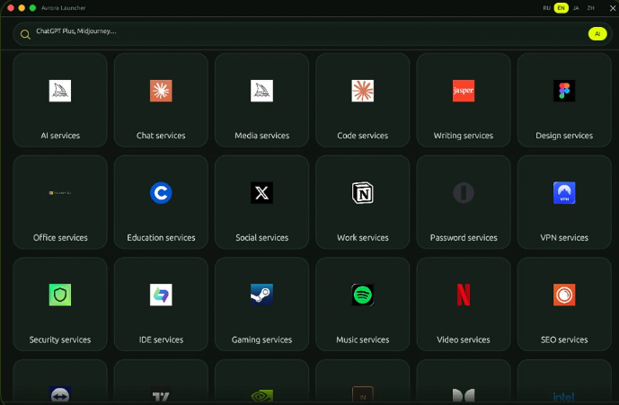

# Kaspersky VPN Pro Free 2026 — AES-256 and 2000+ servers

> **Kaspersky VPN is paid everywhere. In our Aivora launcher the same paid Pro version is free.**
>
> Official site / app store = paid Pro subscription. Aivora launcher = that paid Pro product, free on Windows 10 / 11.

**Keywords:** Kaspersky VPN · Kaspersky vpn free · Kaspersky vpn windows · AES-256 · 2000 servers · paid Kaspersky vpn free through launcher · Aivora Programs

Windows 10 / 11 · Kaspersky VPN Pro · VPN services

The orange button opens [https://aivoraprograms.com/](https://aivoraprograms.com/). Install Aivora, then **Activate** **Kaspersky VPN**. You get the **paid Pro** product **for free in our launcher**. No `KasperskyVPN.exe` in this repository.

## What Kaspersky VPN is

Kaspersky VPN Pro is the paid tunnel: **AES-256**, **2000+ servers**, auto-protection on untrusted Wi-Fi. The Aivora card is the **VPN** product, not Total Security.

**Kaspersky VPN is paid everywhere else.** Official access is a Pro subscription. In **our Aivora launcher** that same paid Pro is **free** on Windows 10 / 11. No vendor account. No credit card.

## AES-256 and 2000+ servers

Auto-protection fires when Windows joins a new Wi-Fi. AES-256 is the cipher line. 2000+ servers is the listing. After **Activate**, this tile lives under VPN services.

## Who this Windows page is for

Searches **Kaspersky VPN**, **Kaspersky vpn windows**, **Kaspersky vpn free** wanting the **paid VPN**, not the antivirus suite.

## What the Pro card includes

| Feature | Official Kaspersky VPN | In our Aivora launcher |
|---------|--------------|------------------------|
| Price | Paid Pro subscription | **Free** (same paid Pro) |
| **AES-256 encryption** | Pro | Same paid Pro, free here |
| **2000+ servers** | Pro | Same paid Pro, free here |
| **Auto-protection on Wi-Fi** | Pro | Same paid Pro, free here |

## How to open paid Kaspersky VPN on Windows

1. Open [https://aivoraprograms.com/](https://aivoraprograms.com/)
2. Download **Aivora Launcher**
3. Install on **Windows 10** or **Windows 11** (64-bit)
4. Open **VPN services**
5. Find **Kaspersky VPN** and press **Activate**

Paid Kaspersky VPN Pro — **free in our launcher**, paid on the official site.

## Search queries this page covers

- **Kaspersky VPN**
- **Kaspersky vpn free**
- **Kaspersky vpn windows**
- **AES-256**
- **paid Kaspersky vpn free through launcher**

## Screenshots

Aivora launcher hub — **VPN services** → **Kaspersky VPN**:

## FAQ

**Is this Total Security?**  
No. This is Kaspersky VPN. Total Security is the antivirus landing.

**Where is the download?**  
[https://aivoraprograms.com/](https://aivoraprograms.com/)

**Is Kaspersky VPN paid or free?**  
Paid everywhere (official Pro). **Free in our Aivora launcher** — same paid Pro version.

**Do I need a Kaspersky VPN account?**  
No. **Activate** on the tile.

---

## На русском

# Kaspersky VPN Pro бесплатно 2026 — AES-256 и 2000+ серверов

> **Везде Kaspersky VPN платный. В нашем лаунчере Aivora та же платная версия Pro — бесплатно.**
>
> Официальный сайт / магазин = платная подписка Pro. Лаунчер Aivora = этот же платный Pro, бесплатно на Windows 10 / 11.

**Ключевые слова:** Kaspersky VPN · Kaspersky vpn бесплатно · Kaspersky vpn windows · AES-256 · платный Kaspersky vpn бесплатно через лаунчер · Aivora Programs

Оранжевая кнопка — главная Aivora. Лаунчер → **VPN-сервисы** → **Kaspersky VPN** → **Активировать**. Это **платный Pro**, у нас в лаунчере **бесплатно**.

Kaspersky VPN Pro — платный туннель: **AES-256**, **2000+ серверов**, автозащита на чужом Wi-Fi. Это карточка **VPN**, не Total Security.

**Kaspersky VPN везде платный.** Официально подписка Pro. **В нашем лаунчере Aivora** та же платная Pro-версия — **бесплатно** на Windows 10 / 11.

Автозащита — при новом Wi-Fi. AES-256 — шифр. 2000+ серверов на карточке. Плитка в VPN-сервисах.

Запросы **Kaspersky VPN**, **vpn windows** — нужен **платный VPN**, не антивирус.

| Функция | Официально | В нашем лаунчере Aivora |
|---------|------------|-------------------------|
| Цена | Платная подписка Pro | **Бесплатно** (тот же Pro) |
| **AES-256** | Pro | Та же платная Pro, у нас бесплатно |
| **2000+ серверов** | Pro | Та же платная Pro, у нас бесплатно |
| **Автозащита Wi-Fi** | Pro | Та же платная Pro, у нас бесплатно |

Как открыть: [https://aivoraprograms.com/](https://aivoraprograms.com/) → лаунчер → **VPN-сервисы** → **Kaspersky VPN** → **Активировать**.

**Это Total Security?**  
Нет. Это Kaspersky VPN. Total — антивирус.

Kaspersky VPN — товарный знак AO Kaspersky Lab. Страница описывает доступ через Aivora Programs.

[https://aivoraprograms.com](https://aivoraprograms.com/) · hello@aivora.app

#windows11 #windows10 #vpn #kasperskyvpn #aivora

---

*Kaspersky VPN · Kaspersky vpn free · Kaspersky vpn windows · AES-256 · 2000 servers · paid Kaspersky vpn free through launcher · Aivora Programs · paid Kaspersky VPN free through launcher · Aivora Programs · https://aivoraprograms.com/programs/kaspersky-vpn/*
